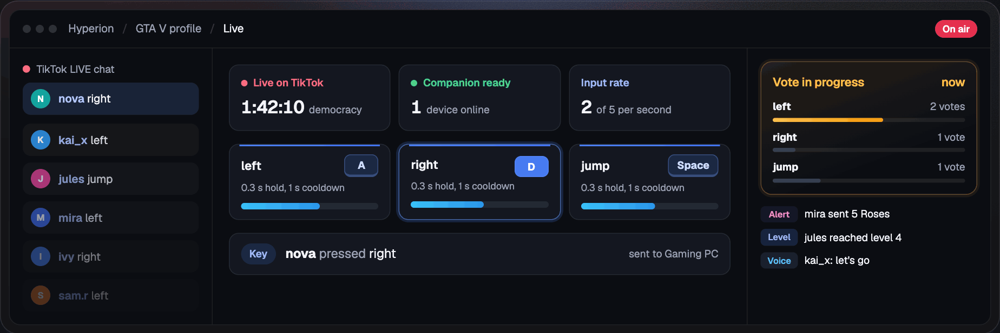
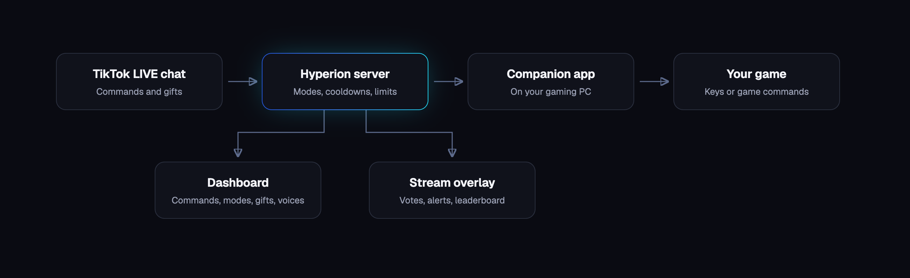
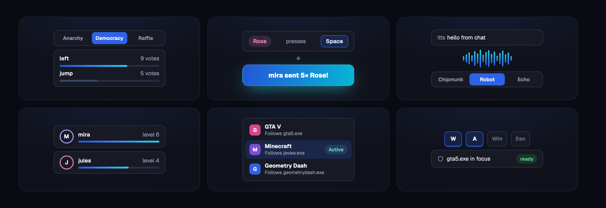
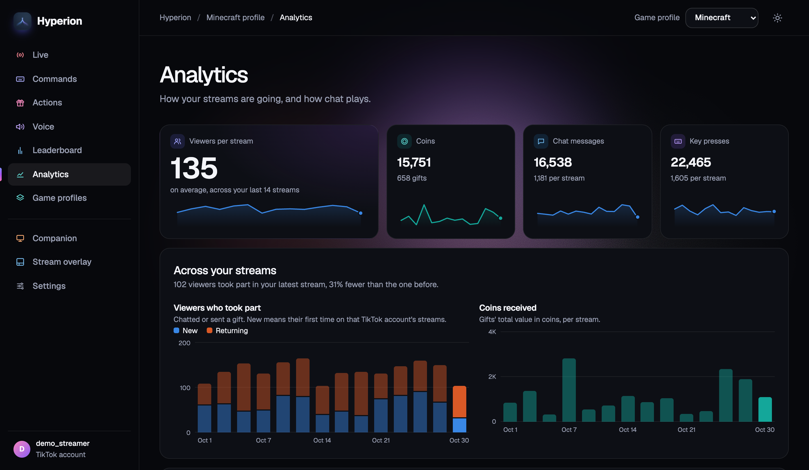

<div align="center">
  <h1><sub></sub> Hyperion</h1>
  <h2>Let your TikTok LIVE chat play your game.</h2>
  <h3>Viewers type commands or send gifts, and Hyperion presses the keys on your PC.</h3>
  <p>Free and open source. Works with the games you already play, on Windows and macOS, with no game mods or plugins.</p>
  <p>
    <a href="https://github.com/dawitmek/Hyperion/releases">Download</a> ·
    <a href="#getting-started">Get started</a> ·
    <a href="#features">Features</a> ·
    <a href="#safety">Safety</a> ·
    <a href="docs/SELF_HOSTING.md">Self-hosting guide</a>
  </p>
  <p>
    <a href="CHANGELOG.md"></a>
    <a href="LICENSE"></a>
    
  </p>
</div>

<p align="center">
  <picture>
    <source media="(prefers-reduced-motion: reduce)" srcset="docs/images/dashboard-preview.png" />
    
  </picture>
  <br />
  <sub>Sample chat · Default dark theme</sub>
</p>

<p align="center">
  <a href="https://github.com/dawitmek/Hyperion/releases"></a>
  <a href="#getting-started"></a>
</p>

## How it works



1. The **server** reads your public LIVE chat by username. It never asks for your TikTok password.
2. It decides what happens, based on your commands, crowd mode, cooldowns and rate limit.
3. It tells the **companion**, a small desktop app paired to your account, which key to press.
4. The **overlay**, a browser source in TikTok LIVE Studio or OBS, shows what chat is doing.

## Features



- **Five crowd modes:** Anarchy (every command fires), Democracy (chat votes), Queue (viewers take turns), Raffle
  (a random viewer's command wins) and Gift-only. Switch any time, even mid-stream.
- **Alerts:** follows, gifts, shares, likes, joins, subscriptions, stickers and commands can show an alert, play a
  sound, show your picture or video, read text aloud, run a command or give points.
- **Overlay editor:** up to eight overlays, each with its own widgets (goals, top gifts, latest follower, stream stats,
  chat, a coin jar, fireworks), placed and sized by dragging, with undo.
- **Game profiles:** each game keeps its own commands and mode, and can follow several programs, like Minecraft Java
  and Bedrock. Ready-made profiles for popular games come with their controls.
- **Game integrations:** commands sent straight into Minecraft (Java and Bedrock), with shareable starter packs. See
  the [Minecraft guide](docs/MINECRAFT.md).
- **Text-to-speech:** read chat, prefixed comments or alerts with Piper, eSpeak, TikTok's voices, your own Google,
  Azure or ElevenLabs key, or the PC's voices.
- **Points, levels and a leaderboard:** viewers earn points and XP, and spend points on commands.
- **Activity and analytics:** a live feed of everything viewers do, and trends across your streams.
- **Test mode:** stream to yourself with auto chat and watch the keys press before you go live.
- **Setup guide:** a welcome window, a checklist and a short tour get a new account ready.



_The Analytics page, shown with sample data._

## Safety

Chat is unpredictable, so the companion is built so it can't take over your PC:

- **Allowed keys only:** each PC keeps its own list. The Windows/Cmd key, Escape, Tab and the F-keys are never
  pressed. Ctrl and Alt are only pressed as part of a command's combination.
- **Combinations need the PC's OK:** the companion lists the dashboard's commands, and each key combination (like
  Ctrl+Shift+E) is only pressed once it's allowed on that PC. The server can propose a combination but never approve
  one.
- **Blocked combinations:** shortcuts that act outside the game, like Ctrl+Alt+Del, Ctrl+W, Alt+F4 and Alt+Enter, are
  refused by both the server and the companion. A combination with Ctrl or Alt is pressed on its own, so viewers'
  overlapping key holds can't add up to one. With Shift alone, other keys can overlap it, so run and jump can happen
  together, unless they'd make a blocked combination.
- **Macros stay on your PC:** you record them in the companion, and only input made while your game has focus is
  kept. The server can ask for one by name but can't create or change one. They stop if the game loses focus, and
  on pause or the panic hotkey, letting go of everything held. Macros are recorded by you, so they can press any
  key the allowed-keys list covers even if you've switched it off, plus mouse clicks and movement.
- **Focus check:** keys go to your game only while its window is in front.
- **Rate limit and cooldowns:** you set a cap on presses per second, and each command has a cooldown per viewer.
- **Panic hotkey:** <kbd>Ctrl</kbd>+<kbd>Shift</kbd>+<kbd>Backspace</kbd> pauses the companion and lets go of every
  held key.

## Getting started

1. **Run a server.** See [Self-hosting](#self-hosting) below. Then sign up in its dashboard and add your TikTok
   username in Settings.
2. **Install the companion** on the PC that runs your game. Get it from the site's Download page or the
   [releases page](https://github.com/dawitmek/Hyperion/releases).
   - The builds aren't code-signed yet, so the first time you open it:
     - on Windows, choose _More info_ and then _Run anyway_
     - on macOS, go to _System Settings → Privacy & Security_ and choose _Open Anyway_
   - On macOS, also allow it under _Accessibility_ so it can press keys.
3. **Pair it.** In the dashboard, open Companion and create a pairing code. Enter the code and the server address in
   the app.
4. **Set up your commands and mode.** New accounts start with w, a, s, d, jump and run, on W, A, S, D, Space and Shift+W.
5. **Add the overlay.** In the dashboard, open Stream overlay and copy its address. Add it as a browser source in
   TikTok LIVE Studio or OBS.
6. **Go live.** Start your TikTok LIVE, focus your game, and press Go live in the dashboard.

## Self-hosting

One container runs the server, dashboard and overlay, and a second runs Postgres. You need Docker and Git.

```sh
git clone https://github.com/dawitmek/Hyperion && cd Hyperion
cp .env.example .env
# edit .env: set POSTGRES_PASSWORD, and SECRETS_KEY to the output of: openssl rand -base64 32
docker compose -f docker/compose.yml --env-file .env pull     # the published image, ghcr.io/dawitmek/hyperion
docker compose -f docker/compose.yml --env-file .env up -d     # or: up -d --build, to build it yourself
```

Hyperion is then on http://127.0.0.1:3000.

- **HTTPS:** built in. Add your domain to `.env` and Caddy handles certificates.
- **Signups:** open until you set `SIGNUPS_ENABLED=false`. Optional email (any SMTP service) adds email confirmation
  and password reset.
- **More:** the step-by-step guide, settings, updates and backups are in [docs/SELF_HOSTING.md](docs/SELF_HOSTING.md).

## Built with Claude

[Claude Code](https://claude.ai), was used in the development of Hyperion.

## License

Hyperion is free software under the [GNU General Public License v3.0 or later](LICENSE). Third-party components keep
their own licenses; see [THIRD_PARTY_NOTICES.md](THIRD_PARTY_NOTICES.md). Hyperion is not affiliated with TikTok.

The original prototype is kept at the `v0-legacy` tag.
